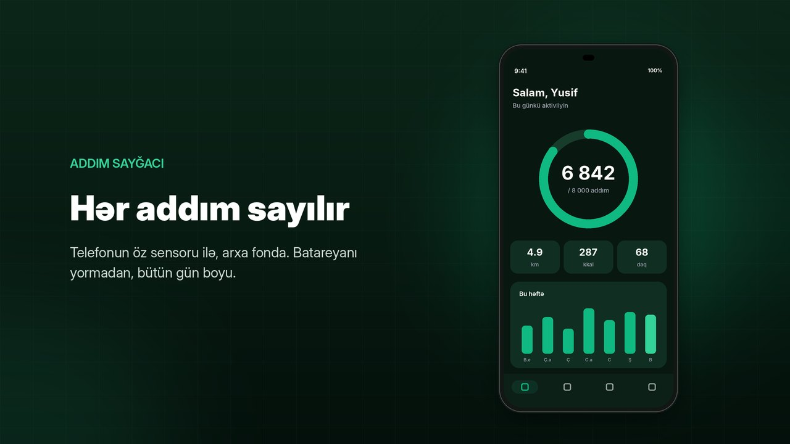
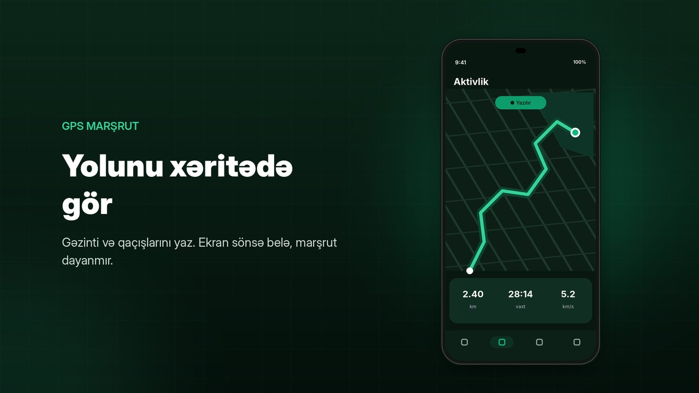
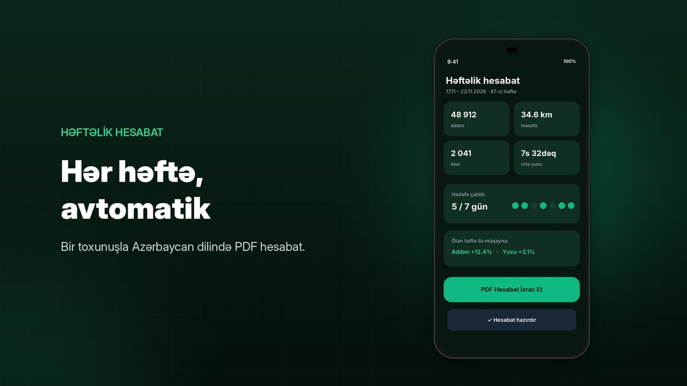
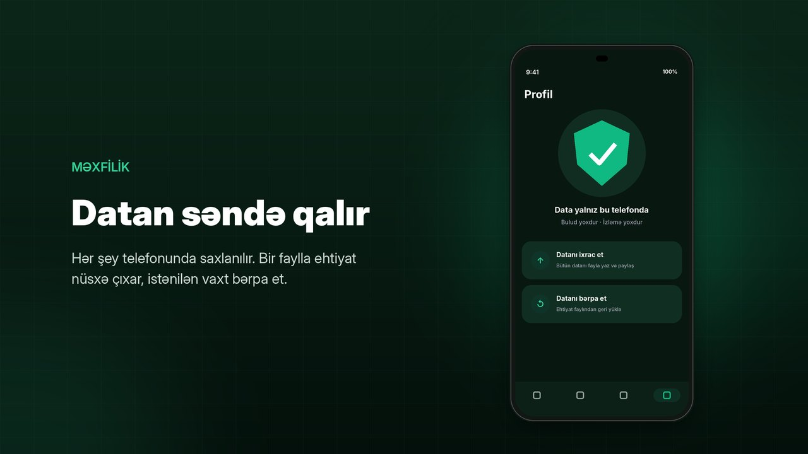

<p align="center">
  
</p>

<p align="center">
  <b>Ağıllı sağlamlıq, sadə həyat.</b><br>
  Privacy-first health &amp; activity tracker for Android, built with Flutter.
</p>

<p align="center">
  <a href="https://github.com/rustamliyusif/yhealth/actions/workflows/flutter.yml"></a>
  
  
  
  
</p>

---

YHealth addımlarını, gəzinti marşrutlarını, yuxunu, çəkini və su qəbulunu izləyən Android tətbiqidir. Bütün sağlamlıq datası yalnız istifadəçinin telefonunda saxlanılır: hesab açmaq tələb olunmur, bulud sinxronizasiyası və izləmə yoxdur.



## Funksiyalar

| | |
|---|---|
| 👟 **Addım sayğacı** | Telefonun öz sensoru (`STEP_COUNTER` / `STEP_DETECTOR`) ilə native foreground service vasitəsilə arxa fonda işləyir. Telefon yenidən başladıqdan sonra da davam edir. |
| 📱 **Ana ekran widget-i** | Addım halqası, məsafə, kalori və aktiv dəqiqələr. App bağlı olanda da yenilənir. |
| 💧 **Su** | Bir toxunuşla +250/+500 ml, çəkiyə görə avtomatik hədəf. |
| 🔔 **Ağıllı xatırlatmalar** | Yalnız lazım olanda: su hədəfindən geri qalanda və ya 1 saat hərəkətsizlikdən sonra. Sakit saatlar ayarlanır. |
| 🔥 **Seriya və nişanlar** | Hədəfə ardıcıl günlər, 11 nişan və irəliləyiş. |
| 🗺️ **GPS marşrut** | Gəzinti və qaçışlar xəritədə yazılır. Ekran sönəndə də marşrut dayanmır. |
| 🌙 **Yuxu** | Yuxu qeydləri, orta müddət və rejim ardıcıllığı. |
| ⚖️ **Çəki və hədəflər** | BMI, BMR/TDEE hesablaması və təhlükəsiz tempdə hədəf planı. |
| 🤖 **Coach Leo** | 25-dən çox mövzuda məsləhət verən oflayn köməkçi. Cavablarda istifadəçinin son 7 günlük addım, yuxu və çəki datasından istifadə edir. Təhlükəli mövzularda həkimə yönləndirir. Ana ekranda gündəlik datadan asılı "günün məsləhəti". |
| ❤️ **Health Connect** | Yuxu (fazalar ilə) və çəki Health Connect-dən oxunur; addımlar və su Health Connect-ə yazılır. |
| 📊 **Həftəlik hesabat** | Avtomatik həftəlik xülasə və tətbiqin dilində PDF ixracı. |
| 💾 **Ehtiyat nüsxə və CSV** | Bütün data JSON faylına ixrac olunur və bərpa edilə bilir. Günlük addım, yuxu, çəki və su CSV kimi Excel üçün ixrac olunur. |
| 🌐 **İki dil, iki rejim** | Azərbaycan və ingilis dilləri, işıqlı və qaranlıq tema. |

<p align="center">
  
  
  
  
</p>

## Məxfilik

- Addım, marşrut, yuxu, çəki və su datası **telefondan çıxmır**. Health Connect ilə mübadilə də telefonun daxilində baş verir.
- İlk açılışda istifadəçi **könüllü olaraq** yalnız ad, soyad və yaşını tərtibatçı ilə paylaşmağa razılıq verə bilər. Razılıq default olaraq söndürülüdür və Profil bölməsindən istənilən vaxt geri götürülə bilər. Geri götürüləndə qeyd buluddan silinir.
- Paylaşılan məlumat Firebase Firestore-da saxlanılır. [`firestore.rules`](firestore.rules) qaydaları hər istifadəçinin yalnız öz qeydini yazmasına icazə verir, siyahını isə yalnız admin oxuya bilir.

## Texnologiyalar

| Sahə | Texnologiya |
|---|---|
| App | Flutter, Dart, Provider |
| Lokal baza | Drift (SQLite), SharedPreferences |
| Native | Kotlin foreground service, App Widget, Health Connect, MethodChannel / EventChannel |
| Xəritə və GPS | flutter_map (OpenStreetMap), geolocator |
| Hesabat | pdf (Roboto şrifti ilə Unicode dəstəyi) |
| Bulud (könüllü) | Firebase Auth (anonim), Cloud Firestore |
| Admin panel | Statik HTML + Firebase Web SDK, Netlify |

## Yükləmə

Ən son APK faylı [Releases](../../releases/latest) bölməsindədir. Əksər müasir telefonlar üçün `arm64-v8a` versiyasını yükləyin.

> Tətbiq Play Store-da olmadığı üçün Android quraşdırma zamanı "Naməlum mənbə" və ya Play Protect xəbərdarlığı göstərə bilər. Bu, tətbiqin özü ilə bağlı problem demək deyil.

## Layihəni işə salmaq

```bash
git clone https://github.com/rustamliyusif/yhealth.git
cd yhealth
flutter pub get
flutter run
```

Bulud funksiyası üçün öz Firebase layihənizdən `google-services.json` faylını `android/app/` qovluğuna əlavə edin. Bu fayl olmadan da tətbiq tam oflayn rejimdə işləyir.

Release build üçün `android/key.properties` faylı yaradın:

```properties
storePassword=...
keyPassword=...
keyAlias=...
storeFile=C:/path/to/keystore.jks
```

```bash
flutter analyze
flutter test
flutter build apk --release --split-per-abi
```

## Layihə strukturu

```
lib/
├── core/
│   ├── database/      # Drift cədvəlləri və miqrasiyalar
│   ├── providers/     # Addım, aktivlik, yuxu, coach, hesabat state-i
│   ├── services/      # Native addım servisi, GPS, PDF, ehtiyat nüsxə, Coach Leo
│   └── theme/         # Rənglər, tipoqrafiya
├── features/          # Ekranlar: dashboard, steps, activity, sleep, coach, reports, profile
└── l10n/              # Azərbaycan və ingilis dilləri
android/app/src/main/kotlin/   # StepCounterService, StepWidgetProvider, ReminderManager, HealthConnectBridge
admin-panel/                   # Netlify admin panel
```

## Müəllif

**Yusif Rustamli**: [GitHub](https://github.com/rustamliyusif)
