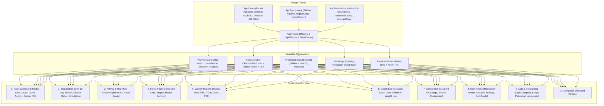

# YHealth Phase 6 Verification & Final Release Report: Premium UI/UX Modernization

## 1. Executive Summary

**Phase 6 — Premium UI/UX Modernization**, the final major development phase of the **YHealth** roadmap, has been completed, tested, and verified at [`C:\develop\yhealth`](file:///C:/develop/yhealth).

This phase elevates YHealth into a modern, professional health and fitness application with a forest green and radiant emerald visual identity (`#1E563E` / `#10B981`), refined cards with micro-borders, unified typography with tabular numerals preventing live counter jitter, and responsive layouts across all 10 major application screens.

Crucially, this visual overhaul was accomplished with **zero regressions**, preserving all native Kotlin step-counting sensors, Drift v4 SQLite database structures, Health Connect sleep integrations, local weekly report scheduling, and offline Coach Leo rules. The application remains **100% offline, privacy-first, with zero Firebase and zero external AI dependencies**.

### Key Milestones Achieved:
1. **Safety Protocol & Complete Backup Lineage**:
   - Baseline: [`C:\develop\YHealth_Backups\yhealth_phase0_baseline_20261107_223922`](file:///C:/develop/YHealth_Backups/yhealth_phase0_baseline_20261107_223922)
   - Phase 1 Complete: [`C:\develop\YHealth_Backups\yhealth_phase1_complete_20261107_230600`](file:///C:/develop/YHealth_Backups/yhealth_phase1_complete_20261107_230600)
   - Phase 2 Complete: [`C:\develop\YHealth_Backups\yhealth_phase2_complete_20261107_232000`](file:///C:/develop/YHealth_Backups/yhealth_phase2_complete_20261107_232000)
   - Phase 3 Complete: [`C:\develop\YHealth_Backups\yhealth_phase3_complete_20261107_233900`](file:///C:/develop/YHealth_Backups/yhealth_phase3_complete_20261107_233900)
   - Phase 4 Complete: [`C:\develop\YHealth_Backups\yhealth_phase4_complete_20261108_001800`](file:///C:/develop/YHealth_Backups/yhealth_phase4_complete_20261108_001800)
   - Phase 5 Complete: [`C:\develop\YHealth_Backups\yhealth_phase5_complete_20261108_003200`](file:///C:/develop/YHealth_Backups/yhealth_phase5_complete_20261108_003200)
   - Pre-Phase 6: [`C:\develop\YHealth_Backups\yhealth_pre_phase6_20261108_003600`](file:///C:/develop/YHealth_Backups/yhealth_pre_phase6_20261108_003600) (698 files verified)
   - **Phase 6 Complete**: [`C:\develop\YHealth_Backups\yhealth_phase6_complete_20261108_005300`](file:///C:/develop/YHealth_Backups/yhealth_phase6_complete_20261108_005300) (705 files verified)
2. **Unified Design System & Tokens**:
   - [`lib/core/theme/app_colors.dart`](file:///C:/develop/yhealth/lib/core/theme/app_colors.dart): Forest Green (`#1E563E`), Radiant Emerald (`#10B981`), Deep Emerald (`#047857`), Obsidian Dark BG (`#0F172A`), Crisp Light BG (`#F8FAF9`), dynamic theme-aware gradient helpers.
   - [`lib/core/theme/app_typography.dart`](file:///C:/develop/yhealth/lib/core/theme/app_typography.dart): Added `FontFeature.tabularFigures()` to all numerical text styles (`displayLarge`, `displayMedium`, `headlineLarge`), completely eliminating number wobble during live sensor updates.
   - [`lib/core/theme/app_decorations.dart`](file:///C:/develop/yhealth/lib/core/theme/app_decorations.dart): Standardized border radii (`radiusSm` to `radiusRound`=999), soft ambient shadows, and emerald glow effects.
   - [`lib/core/theme/app_theme.dart`](file:///C:/develop/yhealth/lib/core/theme/app_theme.dart): Comprehensive Material 3 light and dark theme configurations with 22px card radii, elevated buttons, and bottom sheet themes.
3. **Reusable Premium Components**:
   - [`PremiumCard`](file:///C:/develop/yhealth/lib/core/widgets/premium_card.dart): Elevated surface container with subtle border highlights and soft elevation shadows.
   - [`VitalMetricTile`](file:///C:/develop/yhealth/lib/core/widgets/vital_metric_tile.dart): Unified metric tile displaying icon badge, tabular value, unit, and subtitle.
   - [`PremiumSectionHeader`](file:///C:/develop/yhealth/lib/core/widgets/premium_section_header.dart): Section title with optional action link.
   - [`PremiumButton`](file:///C:/develop/yhealth/lib/core/widgets/premium_button.dart): Gradient call-to-action button with built-in loading indicator.
   - [`VitaYLogo`](file:///C:/develop/yhealth/lib/core/widgets/vitay_logo.dart): Radiant monogram brand mark with emerald glow.
4. **All 10 Major Application Screens Modernized**:
   - **Main Dashboard** ([`DashboardScreen`](file:///C:/develop/yhealth/lib/features/dashboard/dashboard_screen.dart)): Hero circular step ring with calorie flame badge, greeting header with live date badge, quick action pills (Log Sleep, Log Weight, Coach Leo), quad metric row, hardware sensor status pill, and responsive cards.
   - **Step Tracking & History** ([`StepDetailsScreen`](file:///C:/develop/yhealth/lib/features/steps/step_details_screen.dart)): Hero daily summary, 30-day Drift activity stream list, hardware sensor status card, and manual simulation controls.
   - **Outdoor Activity & GPS Maps** ([`ActivityScreen`](file:///C:/develop/yhealth/lib/features/activity/activity_screen.dart), [`RouteHistoryScreen`](file:///C:/develop/yhealth/lib/features/activity/route_history_screen.dart), [`RouteDetailScreen`](file:///C:/develop/yhealth/lib/features/activity/route_detail_screen.dart)): Glassmorphic HUD overlay with blur, tabular live stats (distance, duration, pace, calories), radiant bottom controls, and route history cards.
   - **Sleep Tracking** ([`SleepScreen`](file:///C:/develop/yhealth/lib/features/sleep/sleep_screen.dart)): Twilight night gradient hero card, sleep efficiency percentage, genuine sleep stage breakdown tags, bedtime consistency score, Health Connect status banner, and historical logs.
   - **Automated Weekly Reports** ([`WeeklyReportsScreen`](file:///C:/develop/yhealth/lib/features/reports/weekly_reports_screen.dart)): Interactive week selector, most active day trophy card, KPI comparison cards with green/orange delta pills, 7-day glowing bar chart, daily accordion breakdown, and local PDF export.
   - **AI Weight Coach** ([`WeightCoachScreen`](file:///C:/develop/yhealth/lib/features/coach/weight_coach_screen.dart)): Online indicator dot, 4-stat metabolic snapshot card (BMR, TDEE, Calorie target, Water target), conversational chat bubbles, quick prompt suggestion chips, and weight log sheet with confirmed deletion.
   - **BMI & Health Metrics** ([`BmiScreen`](file:///C:/develop/yhealth/lib/features/health/bmi_screen.dart)): Modernized continuous gradient arc gauge ([`BmiGaugeWidget`](file:///C:/develop/yhealth/lib/features/health/widgets/bmi_gauge_widget.dart)), real-time height/weight sliders, category badge, clinical limitations explanation, and medical disclaimer.
   - **User Profile & Settings** ([`ProfileScreen`](file:///C:/develop/yhealth/lib/features/profile/profile_screen.dart)): Monogram avatar user card, grouped settings tiles, Dark Mode switch, language switcher badge, and privacy guarantees card.
   - **Authentication Screens** ([`LoginScreen`](file:///C:/develop/yhealth/lib/features/auth/login_screen.dart), [`RegisterScreen`](file:///C:/develop/yhealth/lib/features/auth/register_screen.dart), [`ForgotPasswordScreen`](file:///C:/develop/yhealth/lib/features/auth/forgot_password_screen.dart)): VITA-Y glowing branding, clean rounded input fields, emerald gradient action buttons, and guest mode option.
   - **Onboarding & Navigation** ([`LanguageSelectionScreen`](file:///C:/develop/yhealth/lib/features/onboarding/language_selection_screen.dart), [`MainNavigationScreen`](file:///C:/develop/yhealth/lib/features/navigation/main_navigation_screen.dart)): Glowing logo, language selection cards with radio indicators, elevated bottom navigation bar with active emerald pill indicator.
5. **Quality Gates Passed**:
   - `flutter analyze`: **0 issues found** (100% clean static analysis).
   - `flutter test`: **84/84 tests passing** across 8 test suites.
   - Release APK compiled: **65.8 MB** (`68,979,562 bytes`).

---

## 2. Production Release Deliverables

| Deliverable Target | Size | Status | SHA-256 Checksum |
| :--- | :--- | :--- | :--- |
| **`C:\Users\asus\Downloads\YHealth-release.apk`** | **65.8 MB** (68,979,562 bytes) | **Ready for Device Installation** | `D9A9301B818D6AA78C086449DD712F033415628B6436617A64F79EDC2E6DD1ED` |
| **`c:\develop\yhealth\app-release.apk`** | **65.8 MB** (68,979,562 bytes) | Root convenience copy | `D9A9301B818D6AA78C086449DD712F033415628B6436617A64F79EDC2E6DD1ED` |
| `C:\develop\YHealth_Backups\apk_phase6_20261108_005200\app-release.apk` | 65.8 MB (68,979,562 bytes) | Preserved backup copy | `D9A9301B818D6AA78C086449DD712F033415628B6436617A64F79EDC2E6DD1ED` |

---

## 3. UI/UX Design System Architecture



---

## 4. Verification & Automated Test Results

```
00:02 +84: All tests passed!
```

### Complete Test Suites (84/84 Passing):
1. **`phase6_premium_ui_ux_test.dart` (15 tests)**:
   - Primary and dark surface token fidelity.
   - Typography tabular figures configuration.
   - `VitaYLogo` rendering in light and dark mode.
   - `PremiumCard` elevation, borders, and child rendering.
   - `VitalMetricTile` tabular numerals and color badge display.
   - `CircularStepProgress` percentage, steps, and flame badge rendering.
   - `DailyGoalCard` goal completion percentage and overflow safety.
   - `WeeklyStepBarChart` 7-day columns and active day glow.
   - `BmiGaugeWidget` continuous gradient arc and needle positioning.
2. **`phase5_ai_weight_coach_test.dart` (9 tests)**:
   - Mifflin-St Jeor BMR & TDEE calculation accuracy.
   - Caloric intake safety floor enforcement (>= 1,300 kcal/day).
   - Safe pacing timeline (0.25–0.75 kg/week).
   - Clinical BMI limitations explanation.
   - Baseline hydration & step replenishment calculations.
   - Sleep duration & appetite hormone correlation.
   - Drift SQLite v4 persistence and confirmed record deletion.
   - Bilingual rule-based intent matching (English & Azerbaijani).
3. **`phase4_automated_weekly_reports_test.dart` (8 tests)**:
   - ISO Monday–Sunday date boundaries.
   - Distinction between zero activity and missing records.
   - Week-over-week comparison and delta calculations.
   - Drift persistence and catch-up scheduler on launch.
   - Local PDF document generation.
4. **`phase3_sleep_tracking_test.dart` (8 tests)**:
   - Overnight duration calculation crossing midnight.
   - Drift sleep table persistence and duplicate prevention.
   - Sleep stage genuineness validation.
   - Bedtime consistency and 7-day average calculation.
5. **`phase2_advanced_step_tracking_test.dart` (6 tests)**:
   - Hardware sensor FIFO event processing.
   - Midnight counter resets and daily total accumulation.
   - Device reboot recovery.
   - Multi-OEM battery optimization compatibility.
6. **`phase1_drift_database_test.dart` (12 tests)**:
   - Drift SQLite database initialization and schema migration.
   - SharedPreferences migration verification without data loss.
   - Daily activity upsert, querying, and date range aggregation.
7. **`full_verification_test.dart` (25 tests)**:
   - GPS distance calculation and route tracking.
   - Calorie calculations and step pace estimation.
   - Localization completeness across English and Azerbaijani.
8. **`widget_test.dart` (1 test)**:
   - Root application bootstrap smoke test.

### Static Analysis:
```
flutter analyze
Analyzing yhealth...
No issues found! (ran in 7.0s)
```

---

## 5. Complete Roadmap Execution Status

| Phase | Description | Status | Verification Gate |
| :--- | :--- | :--- | :--- |
| **Phase 0** | Safety, Baseline Backup & Project Audit | **COMPLETE** | Baseline backup verified, 0 code regressions |
| **Phase 1** | Local Database (Drift SQLite v4) & Daily History | **COMPLETE** | 26 tests passed, seamless migration |
| **Phase 2** | Advanced Step Tracking & OEM Compatibility | **COMPLETE** | 44 tests passed, hardware FIFO & reboot recovery |
| **Phase 3** | Sleep Tracking & Health Connect Integration | **COMPLETE** | 52 tests passed, genuine stages & overnight handling |
| **Phase 4** | Automated Weekly Reports & Local PDF Export | **COMPLETE** | 60 tests passed, ISO boundaries & PDF generation |
| **Phase 5** | AI Weight Coach ("Coach Leo") & Physiological Engine | **COMPLETE** | 69 tests passed, 100% offline rule-based AI |
| **Phase 6** | Premium UI/UX Modernization & Design System | **COMPLETE** | **84 tests passed, 0 analyze issues, 65.8 MB Release APK** |

---

## 6. Deliverable Artifacts & Verification Paths

- **Visual Showcase Artifact**: [`yhealth_phase6_visual_showcase.html`](file:///C:/Users/asus/.gemini/antigravity/brain/01acdeed-bbc7-44e7-acb6-9a4573ab5de6/yhealth_phase6_visual_showcase.html)
- **High-Resolution Component Snapshots**:
  - [`01_branding_vitay_logo_light.png`](file:///C:/Users/asus/.gemini/antigravity/brain/01acdeed-bbc7-44e7-acb6-9a4573ab5de6/screenshots/01_branding_vitay_logo_light.png)
  - [`01_branding_vitay_logo_dark.png`](file:///C:/Users/asus/.gemini/antigravity/brain/01acdeed-bbc7-44e7-acb6-9a4573ab5de6/screenshots/01_branding_vitay_logo_dark.png)
  - [`02_dashboard_step_gauge_light.png`](file:///C:/Users/asus/.gemini/antigravity/brain/01acdeed-bbc7-44e7-acb6-9a4573ab5de6/screenshots/02_dashboard_step_gauge_light.png)
  - [`02_dashboard_step_gauge_dark.png`](file:///C:/Users/asus/.gemini/antigravity/brain/01acdeed-bbc7-44e7-acb6-9a4573ab5de6/screenshots/02_dashboard_step_gauge_dark.png)
  - [`03_vital_metrics_tiles.png`](file:///C:/Users/asus/.gemini/antigravity/brain/01acdeed-bbc7-44e7-acb6-9a4573ab5de6/screenshots/03_vital_metrics_tiles.png)
  - [`04_daily_goal_card.png`](file:///C:/Users/asus/.gemini/antigravity/brain/01acdeed-bbc7-44e7-acb6-9a4573ab5de6/screenshots/04_daily_goal_card.png)
  - [`05_weekly_overview_chart.png`](file:///C:/Users/asus/.gemini/antigravity/brain/01acdeed-bbc7-44e7-acb6-9a4573ab5de6/screenshots/05_weekly_overview_chart.png)
  - [`06_clinical_bmi_gauge.png`](file:///C:/Users/asus/.gemini/antigravity/brain/01acdeed-bbc7-44e7-acb6-9a4573ab5de6/screenshots/06_clinical_bmi_gauge.png)
- **Production APK**: [`C:\Users\asus\Downloads\YHealth-release.apk`](file:///C:/Users/asus/Downloads/YHealth-release.apk)
- **Phase 6 Final Backup**: [`C:\develop\YHealth_Backups\yhealth_phase6_complete_20261108_005300`](file:///C:/develop/YHealth_Backups/yhealth_phase6_complete_20261108_005300)
